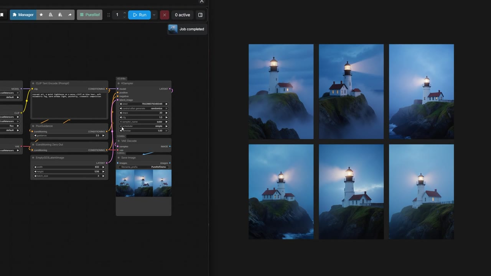

# PureRef Connector for ComfyUI

Sends images from the built-in **Save Image** node to a PureRef board. No extra nodes.

Windows only. Tested with PureRef 2.1.3.

[Watch the 32-second demo](https://github.com/doubletwisted/ComfyUI-PureRef-Connector/blob/main/assets/pureref-connector-demo.mp4)

## Install

Install **PureRef Connector** from ComfyUI-Manager, or clone this repo into `ComfyUI/custom_nodes`.

## Use

1. Click **PureRef** in the ComfyUI toolbar.
2. Enter the path to a `.pur` file. It's created if it doesn't exist.
3. Check **Enable** and click **Apply**.

New images are added to the board in rows, starting at the top-left of the canvas. Keep that area free of your own references.

**Save images to**
- **PureRef + normal output folder**: images go to both.
- **PureRef only**: images only go to the board.

If PureRef can't take an image, it's saved to the normal output folder and you get a warning.

## Notes

- The board pauses for a moment while new images are added. Your own edits are saved first.
- Close any other PureRef window that has the same board open.
- Open ComfyUI through `localhost` or `127.0.0.1`. PureRef must run on the same computer.
- To get a workflow back, export the image from PureRef with **Format: Original** and cropping off, then drag it into ComfyUI.
